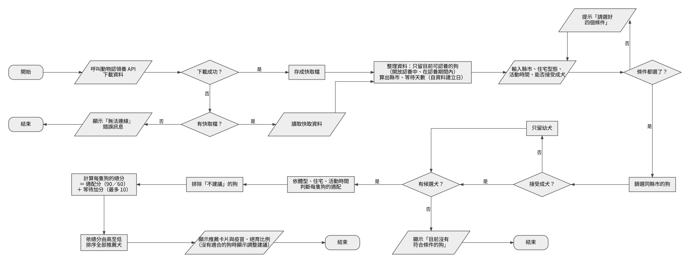

# 🐕 收容犬認養媒合推薦系統

依使用者的**居住縣市、住宅型態、每日可陪伴外出活動時間、能否接受成犬**，從農業部「動物認領養」開放資料中推薦適合的待認養犬，並讓在收容所等待較久的狗被優先看見。

> 本系統是認養前的自我評估工具，不是認養審核工具；實際認養資格與流程以各收容所公告為準。

## 功能

- 串接農業部「動物認領養」API，只顯示目前可以認養的狗（開放認養中、在認養期間內）
- 依體型、住宅型態與活動時間判斷適配程度（適合／尚可／不建議）
- 依總分由高至低排序：總分 = 適配分（適合 90、尚可 60）＋ 等待加分（最多 10 分）
- 顯示推薦犬的照片、等待天數、狂犬病疫苗與絕育狀態，以及收容所聯絡方式
- API 連線失敗時改用上次下載的快取資料

## 執行方式

```bash
pip install -r requirements.txt
python app.py
```

用瀏覽器開啟終端機顯示的網址（預設為 http://127.0.0.1:7860）。

## 程式流程圖



## 資料來源與授權

- 農業部「動物認領養」開放資料：https://data.gov.tw/dataset/85903
- 依「政府資料開放授權條款－第 1 版」使用，資料內容以農業部公告為準

## 生成式 AI 使用聲明

本專案開發過程使用 Claude 協助查找佐證資料、撰寫與除錯程式；AI 提供的數據、網址與程式皆經人工查證與實際資料測試。

## 課程

國立中興大學「資訊素養」期末報告示範
